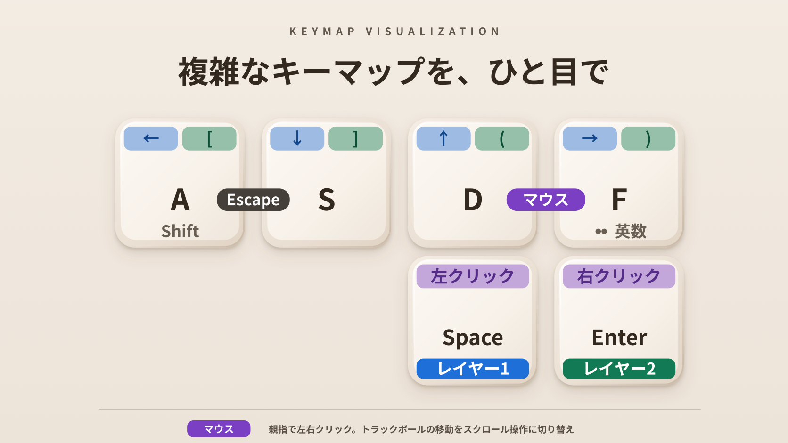
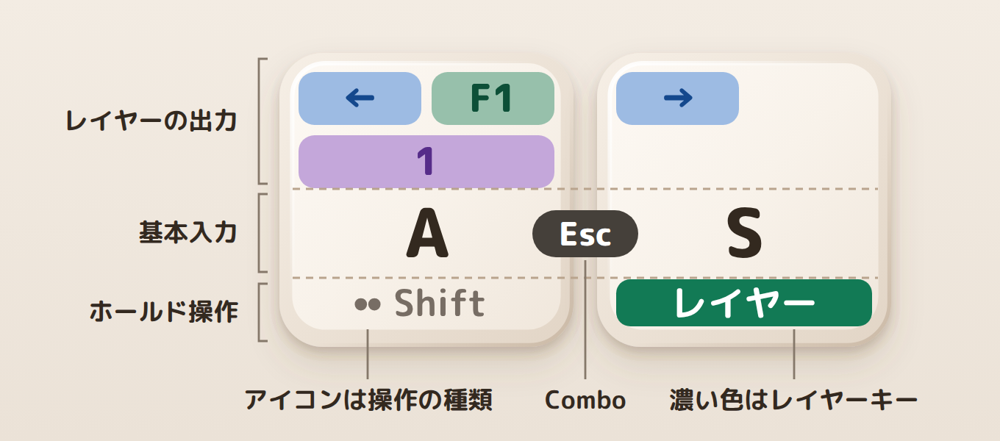
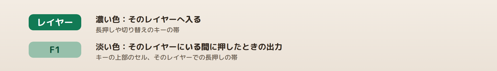

# keymap-visualization



ZMK や QMK のキーマップを、1 枚のキーマップビジュアルで把握できるようにするためのデザインルールと描画プログラムです。複数のレイヤー、Hold-Tap、Tap Dance、Combo を、物理キーの配置のまま 1 セットのキーにまとめて描きます。

## クイックスタート

キーマップビジュアルは、Claude などの LLM に作らせる前提です。仕様とキーマップのリポジトリを渡して、次のように依頼します。

```text
https://github.com/ma9eo/keymap-visualization の仕様に沿って、
https://github.com/ma9eo/zmk-keyboard-torabo-tsuki-lp をキーマップビジュアルにしてください。
全ておすすめ設定で。
```

LLM は、キーマップと設定ファイルを読み、仕様に沿ってキーマップビジュアルの内容を中間データ（JSON）にまとめ、描画プログラムで SVG を描きます。対象 OS や表示言語など、キーマップから決められない項目は、ふだんは描く前に質問されます。「全ておすすめ設定で」と書いておくと、質問せずにおすすめの値で描きます。

## キーマップビジュアルの読み方

### キーの表記



### 色のルール



### 操作アイコン


